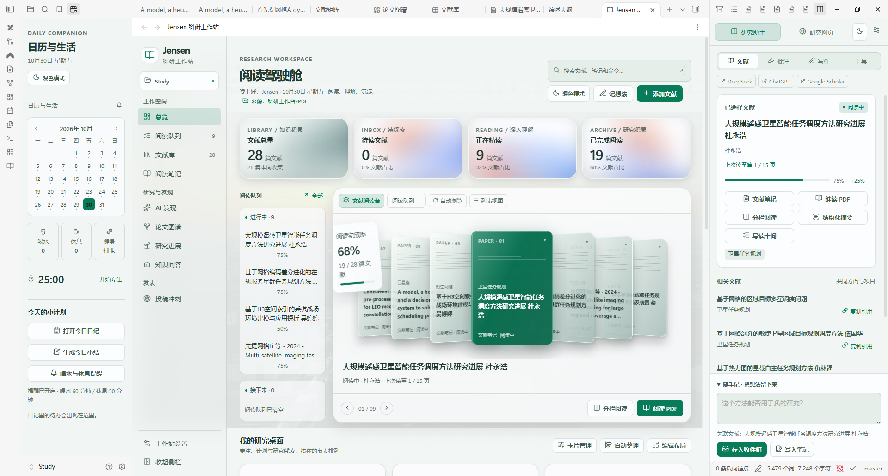
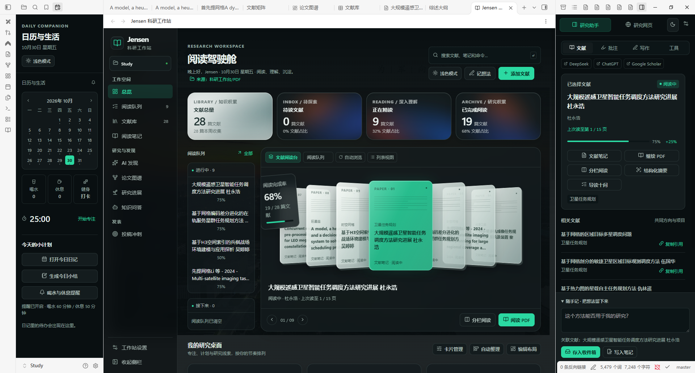

# v0.21.0 · 阅读续读与批注管理

2026-10-30。在 v0.20 的玻璃阅读台上继续迭代，重点完善实际阅读流程和侧栏可用性。

## 本轮改进

- **直接阅读**：点击 3D 卡片、列表卡片、文献库标题或阅读队列，默认在当前区域打开 PDF 标签页，不再强制先开笔记与分栏。需要对照笔记时使用独立的「分栏阅读」按钮；重复分栏复用原窗格，切回普通阅读会收起本次创建且未被另作他用的阅读分栏。
- **图标与打开链路**：左上角换为简洁书页标识。修正工作台/侧栏激活时的异步焦点问题；复用标签页前检查文件是否已被用户切换，保护独立打开的其他笔记。
- **PDF 续读**：自动保存页码与缩放；从分栏阅读或 PDF 按钮重新打开时恢复位置。侧栏页码随原生 PDF 翻页实时同步，更新时保留正在输入的批注。AI 提取正文也会保留已有阅读位置。
- **批注管理**：可编辑评论和颜色，搜索原文/评论，按颜色筛选、按页码或最近修改排序，复制带页码的引用。支持展开长批注、显示更多记录、删除撤销。
- **草稿与异步结果**：同次会话切换选区或 PDF 会保留对应草稿；旧选区的翻译或保存完成后，不会覆盖新选区内容。同页重复文字按文本位置区分。
- **Markdown 数据保护**：编辑与撤销只替换对应批注块，保留其他手写内容；同一 PDF 的批注操作排队执行，避免同时保存时丢记录；过期编辑窗口会拒绝覆盖较新的修改。
- **3D 阅读台**：增加阅读队列/正在读/待读/全部范围筛选；显示选中文献的完整标题与上次阅读页码。3D 模式最多挂载七张可见卡片。空队列会提供查看全部的入口，并禁用不适用操作。
- **视觉整理**：缩短首页页头和统计卡，保留玻璃材质与透视卡组；移除右栏重复标题和计时器，将主题与设置收进顶部。正文输入和引用区域字号更清晰，260px 窄侧栏也可操作。
- **网页体验**：常用链接修改后立即刷新，保留原有网页实例；前后退按实际可用状态启用；加载失败提示不会被随后的停止加载事件隐藏。
- **上下文一致性**：旧 PDF 的信息不再覆盖主页刚选中的文献。

## 验证

27 项 Node 逻辑检查、23 项 Obsidian 实机集成检查，以及九个主页面和四个助手模式的界面检查均通过。

实机覆盖卡片/标题直达 PDF、普通/分栏阅读切换、独立窗格保护、PDF 翻页同步、重新打开续读、AI 取文保留书签、真实选区草稿、批注编辑/检索/撤销、Markdown 手写内容保护、3D 联动与筛选、网页实例保留，以及 260/320/386px 侧栏和 390/720/1248px 主区。

```powershell
node tools/build.mjs
node --check main.js
node --test tests/core.test.cjs
node tools/verify-v020.mjs
node tools/check-surfaces.mjs
node tools/capture-v020.mjs v021
```

工具文件名沿用 v020，但检查的是当前运行版本。AI 集成测试使用受控响应，本轮没有重复请求真实 AI API。

## 数据说明

- 阅读位置在 `data.json` 的 `pdfReadingPositions`，与手动阅读完成度分别保存。
- 批注继续保存在 `pdfAnnotations` 并同步对应 Markdown；原 PDF 二进制保持原样。
- 草稿恢复和删除撤销作用于当前会话；正式保存的批注和阅读位置可跨重启保留。
- 更新保留现有文件夹来源、明暗主题、账号登录分区和已有笔记。




