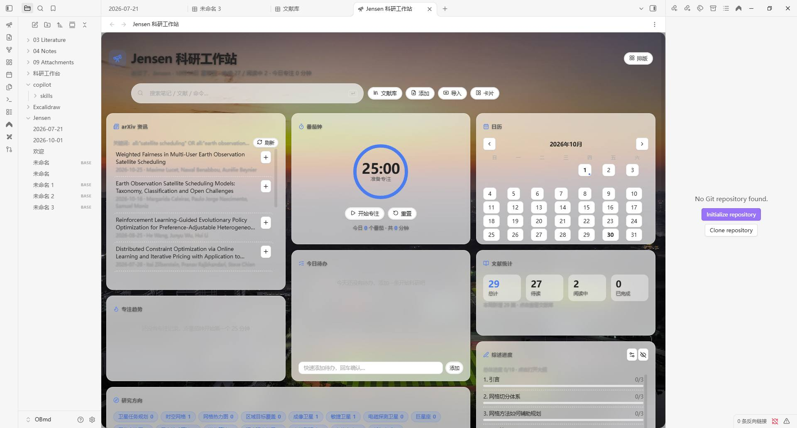

# Jensen 科研工作站 (Jensen Research Workstation)

**为科研人打造的 Obsidian 一体化工作台**：卡片仪表盘 × 文献工作流 × arXiv 资讯 × AI 辅助，中文优先设计。

> 融合 [Hearth](https://github.com/ondreu/Hearth)（MIT）的卡片仪表盘美学与 [Research OS](https://github.com/kivvng726/obsidian-research-os)（MIT）的文献工作流思路，取长补短、专注科研场景。感谢两个优秀开源项目的启发。

## ✨ 功能全景

### 🏠 卡片仪表盘（可拖拽排序 · 三档宽度 · 自由显隐）
| 内置卡片 | 说明 |
|---|---|
| **arXiv 资讯** ⭐ | 按你的关键词自动拉取最新论文（12h 缓存），一键入库 |
| **番茄钟** | 环形进度、专注/小憩/长休流转、记录写入日记 |
| **日历** | 月视图 + 日记点 + 专注热力点，点击直达当日日记 |
| **今日待办** | 读写日记中的 `- [ ]` 任务，快速添加 |
| **文献统计 / 专注趋势 / 最近文献** | 数据一目了然 |
| **研究方向** | 领域标签云（预置卫星规划方向），点击筛选文献库 |
| **综述进度** | 按 `##` 章节 + 任务勾选统计写作进度 |
| **快速启动** | 常用动作九宫格 |

**自定义卡片**：笔记嵌入 / 倒计时 DDL / 网页 / 命令组——通过「卡片管理」添加，与内置卡片同样可拖拽、调宽度。

### 🔍 全局搜索（顶部 omnibox）
一次搜索 **笔记 · 文献 · 命令**，↑↓ 选择、回车打开（借鉴 Hearth 搜索中心）。

### 📚 文献库
- 卡片化管理：标题 / 作者 / 年份 / 来源 / 方向 / 状态 / 评分星
- 状态流：待读 → 阅读中 → 已完成 → 已归档（点击胶囊流转）
- **批量导入**：扫描本地 PDF 文件夹（含子目录），默认**复制 PDF 入库**，在 Obsidian 内直接阅读与高亮批注（原生 PDF 查看器）
- 外部 PDF 一键入库迁移
- **文献矩阵**：一键生成综述对比总表
- 文献笔记模板：一句话总结 / 问题设定 / 网格方法 / 求解算法 / 可借鉴点

### 🤖 AI 与解析
- **AI 摘要**：任何 OpenAI 兼容 API（DeepSeek / GLM / OpenAI…），一键把笔记骨架补全成要点
- **MinerU 集成**：本地安装 [MinerU](https://github.com/opendatalab/MinerU) 后，可将文献 PDF 高质量解析为 Markdown 写回笔记（吸取 MinerU 的 PDF→MD 价值）

### 🎨 外观
- 自定义背景：**纯色 / 你的照片**（库内任意图片）+ 毛玻璃联动增强
- 六种强调色、明暗自适应、减弱动态支持

### 🧭 研究方向预设（开箱即用）
卫星任务规划、时空网格、网格热力图、区域目标覆盖、成像卫星、敏捷卫星、电磁探测卫星、巨星座、天临空协同、元启发式算法、进化算法、深度强化学习、大模型驱动、在轨自主、任务生成（可增删）。

## 🆕 v0.3「真·自由看板」

- **自由拖拽看板**（借鉴 Hearth grid 引擎）：卡片带网格坐标，`排版` 模式下拖动移动、右下角缩放、双击配置，松手即存
- **卡片编辑**：每张卡 ⚙ 可改标题与专属参数（arXiv 条数/关键词等）；隐藏/删除随手可做
- **Hero 页头**：大标题 + 品牌位 + 充足留白 + 全局搜索
- **外观工作室**：模糊量 / 卡片不透明度 / 圆角 / 间距 / 背景暗化 / 看板列数 / 自定义 HEX 强调色，全部实时可调
- **Research OS 功能对齐**：生成 **Bases 数据库**（文献库/阅读队列）、文献**优先级**流转、**AI 补全元数据**、**AI 导读十问**、**AI 跨论文综述**、**分栏阅读**（笔记+PDF 并排）

## 📦 安装

**BRAT（推荐）**：安装 [BRAT](https://github.com/TfTHacker/obsidian42-brat) → Add Beta plugin → `Jensen-Yao/jensen-workstation`

**手动**：从 [Releases](../../releases) 下载 `main.js / manifest.json / styles.css` 放入 `<库>/.obsidian/plugins/jensen-workstation/`，重启并启用。

## 🚀 快速上手

1. 点左侧 📡 图标打开仪表盘
2. 「批量导入」→ 选 PDF 文件夹 → PDF 复制入库 + 自动建卡
3. 「初始化综述大纲」→ 生成进度化大纲
4. 顶栏搜索任何东西；拖动卡片头部调整布局
5. 设置 → AI 摘要 → 填 API Key，文献卡上点 ✨ 生成摘要

## 🗂 数据约定（纯 Markdown，卸载不丢）

- 文献笔记：`科研工作台/文献/*.md`（YAML frontmatter）
- PDF：`科研工作台/PDF/`
- 综述大纲 / 文献矩阵：`科研工作台/`
- 专注记录：当日日记 `🍅` 条目

## 🙏 致谢

- [Hearth](https://github.com/ondreu/Hearth)（MIT）— 卡片化主页与搜索中心的产品思路
- [Research OS](https://github.com/kivvng726/obsidian-research-os)（MIT）— 文献状态流与研究方向组织思路
- [MinerU](https://github.com/opendatalab/MinerU) — PDF→Markdown 解析能力（外部 CLI 集成）

## 📄 许可

[MIT](LICENSE) © Jensen-Yao
