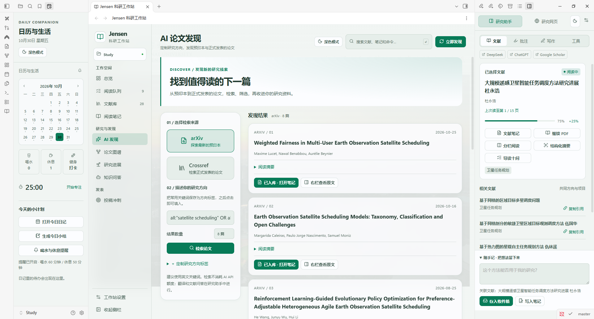
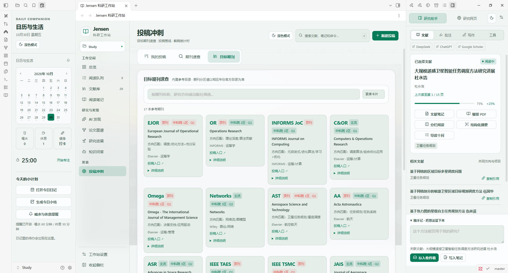

# Jensen 科研工作站 (Jensen Research Workstation)

**为科研人打造的 Obsidian 一体化工作台**：卡片仪表盘 × 文献工作流 × arXiv 资讯 × AI 辅助，中文优先设计。

> 融合 [Hearth](https://github.com/ondreu/Hearth)（MIT）的卡片仪表盘美学与 [Research OS](https://github.com/kivvng726/obsidian-research-os)（MIT）的文献工作流思路，取长补短、专注科研场景。感谢两个优秀开源项目的启发。

## v0.22 · 全页面工作区与可定制方向

AI 发现支持方向标签与右栏原文；投稿分成管线、速查和紧凑期刊目录。阅读队列、笔记书架、实时主题图谱和章节进展分别重构，研究桌面可折叠，设置支持分类搜索。

[下载 v0.22.0](https://github.com/Jensen-Yao/jensen-workstation/releases/tag/v0.22.0)

[本轮变更](CHANGES-v0.22.md) · [AI 发现预览](screenshots/v022/discover-day.png) · [期刊目录预览](screenshots/v022/journals-day.png) · [设置预览](screenshots/v022/settings.png)

其他页面：[文献库](screenshots/v022/library-day.png) · [阅读队列](screenshots/v022/queue-day.png) · [笔记书架](screenshots/v022/reader-day.png) · [主题图谱](screenshots/v022/graph-day.png) · [写作进展](screenshots/v022/progress-day.png) · [投稿管线](screenshots/v022/submit-day.png) · [文献问答](screenshots/v022/ask-day.png) · [研究桌面](screenshots/v022/lower-desktop.png)

开发与验证见 [tools/README.md](tools/README.md)。当前工具集已移除历次一次性补丁和旧 QA 脚本，历史实现仍可通过 Git 查阅。

## v0.21 · 阅读续读与批注管理

点击卡片或文献标题直接阅读 PDF，分栏阅读作为独立选项。PDF 自动记住页码与缩放；批注可编辑、搜索、筛选和撤销删除。切换选区保留会话草稿，3D 阅读台显示完整标题与阅读位置，右栏进一步精简，左上角换为简洁书页标识。

[本轮变更与验证](CHANGES-v0.21.md) · [白昼预览](screenshots/v021-day.png) · [夜航预览](screenshots/v021-night.png)

## v0.20 · 玻璃阅读台与研究伴侣

- **真实 3D 文献卡组**与队列、右侧详情联动，支持列表与自动浏览。
- **按文件夹管理文献**：选择来源目录，扫描本地 PDF；文件夹右键也可设为来源。未索引的 PDF 在首次精读时建立笔记。
- **PDF 阅读、批注、翻译**：默认直接打开 PDF，可选择笔记/PDF 在中心并排；PDF 选区送到右栏，可高亮、评论、翻译并保存带页码的 Markdown。插件高亮保存在本地，不修改原 PDF。
- **一个右侧入口**：助手与网页内部切换；DeepSeek 直接在右栏打开，登录状态使用本机持久化分区保留。
- **Obsidian 原生左栏**：月历、番茄钟、喝水/休息记录、健身打卡、提醒和日记待办。
- **白昼 / 夜航玻璃**直接切换；字号与对比优化；检索、批量撤销、CSV/BibTeX 导出。

从命令面板选择「Jensen 科研工作站：打开工作站」即可展开两侧面板。在 PDF 中选中文字后，右栏进入批注模式。常用链接在右栏「工具」中管理；提醒间隔在左栏的铃铛中设置。

[v0.20 白昼阅读台](screenshots/v020-day.png) · [v0.20 夜航阅读台](screenshots/v020-night.png)

[本轮变更与验证](CHANGES-v0.20.md) · [开发交接](HANDOFF.md)

## 早期功能介绍与版本记录

## ✨ 功能全景

### 🏠 卡片仪表盘（可拖拽排序 · 三档宽度 · 自由显隐）
| 内置卡片 | 说明 |
|---|---|
| **arXiv 资讯** ⭐ | 按你的关键词自动拉取最新论文（12h 缓存），一键入库 |
| **番茄钟** | 环形进度、专注/小憩/长休流转、记录写入日记 |
| **日历** | 月视图 + 日记点 + 专注热力点，点击直达当日日记 |
| **今日待办** | 读写日记中的 `- [ ]` 任务，快速添加 |
| **文献统计 / 专注趋势 / 最近文献** | 数据一目了然 |
| **研究方向** | 领域标签云（预置卫星规划方向），点击筛选文献库 |
| **综述进度** | 按 `##` 章节 + 任务勾选统计写作进度 |
| **快速启动** | 常用动作九宫格 |

**自定义卡片**：笔记嵌入 / 倒计时 DDL / 网页 / 命令组——通过「卡片管理」添加，与内置卡片同样可拖拽、调宽度。

### 🔍 全局搜索（顶部 omnibox）
一次搜索 **笔记 · 文献 · 命令**，↑↓ 选择、回车打开（借鉴 Hearth 搜索中心）。

### 📚 文献库
- 卡片化管理：标题 / 作者 / 年份 / 来源 / 方向 / 状态 / 评分星
- 状态流：待读 → 阅读中 → 已完成 → 已归档（点击胶囊流转）
- **批量导入**：扫描本地 PDF 文件夹（含子目录），默认**复制 PDF 入库**，在 Obsidian 内直接阅读与高亮批注（原生 PDF 查看器）
- 外部 PDF 一键入库迁移
- **文献矩阵**：一键生成综述对比总表
- 文献笔记模板：一句话总结 / 问题设定 / 网格方法 / 求解算法 / 可借鉴点

### 🤖 AI 与解析
- **AI 摘要**：任何 OpenAI 兼容 API（DeepSeek / GLM / OpenAI…），一键把笔记骨架补全成要点
- **MinerU 集成**：本地安装 [MinerU](https://github.com/opendatalab/MinerU) 后，可将文献 PDF 高质量解析为 Markdown 写回笔记（吸取 MinerU 的 PDF→MD 价值）

### 🎨 外观
- 自定义背景：**纯色 / 你的照片**（库内任意图片）+ 毛玻璃联动增强
- 六种强调色、明暗自适应、减弱动态支持

### 🧭 研究方向预设（开箱即用）
卫星任务规划、时空网格、网格热力图、区域目标覆盖、成像卫星、敏捷卫星、电磁探测卫星、巨星座、天临空协同、元启发式算法、进化算法、深度强化学习、大模型驱动、在轨自主、任务生成（可增删）。

## 🆕 v0.3「真·自由看板」

- **自由拖拽看板**（借鉴 Hearth grid 引擎）：卡片带网格坐标，`排版` 模式下拖动移动、右下角缩放、双击配置，松手即存
- **卡片编辑**：每张卡 ⚙ 可改标题与专属参数（arXiv 条数/关键词等）；隐藏/删除随手可做
- **Hero 页头**：大标题 + 品牌位 + 充足留白 + 全局搜索
- **外观工作室**：模糊量 / 卡片不透明度 / 圆角 / 间距 / 背景暗化 / 看板列数 / 自定义 HEX 强调色，全部实时可调
- **Research OS 功能对齐**：生成 **Bases 数据库**（文献库/阅读队列）、文献**优先级**流转、**AI 补全元数据**、**AI 导读十问**、**AI 跨论文综述**、**分栏阅读**（笔记+PDF 并排）

## 🆕 v0.4「应用壳层」—— 对齐 Research OS 骨架

- **左侧栏导航**（可折叠成图标栏 / 隐藏）：品牌区 + 7 区段 + 库统计
- **区段化工作区**：🏠 总览看板 · ✨ AI 发现（arXiv 即时检索）· 📋 阅读队列（优先级分组+阅读进度条）· 📚 文献库 · 🔗 论文图谱（一键生成 Canvas 关系图）· 🌱 研究进展（大纲进度+研究问题清单）· 📖 阅读笔记（分栏精读+AI）
- **每区段 Topbar**：大标题 + 副标题 + 全局搜索 + 区段主按钮
- **阅读进度系统**：`reading_progress` 0-100，>0 自动转阅读中、100 自动完成
- **研究问题**：疑问沉淀为问题笔记，状态流转

## 🆕 v0.5「投稿冲刺」—— 锚定 EJOR 等顶刊

- **目标期刊速查**：内置 15 本（EJOR / OR / INFORMS JoC / C&OR / Omega / Networks / AST / Acta Astronautica / ASR / IEEE TAES / TSMC / JAIS / 宇航学报 / 航空学报 / 系统工程与电子技术），含定位标签、方向匹配点、投稿入口链接
- **投稿管线**：新建投稿（关联目标刊 + 截稿日）→ 状态流（写作中→准备→已投→审稿→大修/小修→接收/拒稿/改投）一键流转，DDL 倒计时实时显示
- 投稿笔记自带写作计划模板（模型/算法/实验/综述/格式五步）与审稿回应区

## 🆕 v0.6「知识问答」—— 引入腾讯 ima 的哲学

> ima 的核心理念：你的知识库就是 AI 的大脑——一切收藏皆上下文，回答必带来源，问答可沉淀。

- **知识问答题段**：向 AI 提问 → 自动检索你的文献库做 grounding（标题/方向/摘要关键词打分 + 评分/优先级权重，top 6 进上下文）→ 回答**带来源引用**，来源芯片可点击直达文献笔记
- **沉淀闭环**：满意的回答一键转为「研究问题」笔记（问题 + AI 解答 + 来源）
- **快速捕获收件箱**：任何时刻 `Ctrl+P → 快速记想法`，想法带时间戳落入 `科研工作台/收件箱/今日.md`

## 🆕 v0.7「质量收口」—— 零假功能承诺

- **全站交互审计**：CDP 自动遍历 9 区段 258 个可点元素逐一真实点击 + 反应检测（DOM/Notice/弹窗/外链）
- **修复 5 处真死点**：AI 发现的检索/入库、知识问答的提问（原生按钮误用组件 API 导致处理器中断）、提问空输入静默
- **修复视图吞并 bug**：新增 smartOpenFile——在工作站内打开文件一律开新标签页，工作台视图不再被文件顶掉（17 处调用全部替换）
- **新真功能：AI 起草章节**——研究进展里每章一个 ✨，检索文献库后把带来源的初稿写回大纲（callout 标注，重复起草自动覆盖旧稿）
- 复验：修复后全部交互均有可感知反馈

## 🆕 v0.8「日常手感」

- **编辑器 AI 三连**：任意笔记选中段落 → 命令面板或右键菜单「学术润色 / 扩写深化 / 精简提炼」，结果直接替换选区（Ctrl+Z 可撤销）
- **问答历史持久化**：知识问答自动存档 `科研工作台/AI问答/日期.md`，重开 Obsidian 不丢，来源双链可点
- **今日小结**：一键把今日番茄/新增文献/待解问题/投稿状态写入日记（纯本地汇总，不耗 AI）
- 「立即发现」等长任务按钮补即时反馈；全站交互审计回归通过

## 🆕 v0.9「分区与双源检索」

- **中科院分区**：目标期刊卡显示「中科院 X 区 · JCR Qx」徽章（参考值，以最新官方表为准）；文献卡 / 阅读队列 / 阅读笔记 / 文献矩阵在 venue 匹配目标期刊时自动标注分区
- **Crossref 正式期刊检索**：AI 发现新增源切换（arXiv 预印本 / Crossref 期刊），搜正式发表论文自动标分区，一键入库（带 DOI 链接）
- 修复：主页卡片全被隐藏后一片空白（审计误点「隐藏卡片」所致）的快速恢复路径

## 🆕 v0.10「期刊雷达 + 全新主页」

- **期刊速查器**（投稿冲刺区段）：输入任意期刊/会议名 → 一屏显示 **CCF 第七版(2026) 680条含会议 · 科协目录（运筹与管理 A-D 56刊 + 航空航天 T1-T3 62刊）· 中科院2025升级版 21772刊 · 新锐2026 22299刊 · 预警名单**；全量库一键下载本地缓存，之后离线秒查
- **venue 自动分级**：添加文献时输入期刊名实时识别分区；保存自动写入 frontmatter（cas/cas_top/xr_zone/ccf/cast_tier），文献卡/队列/矩阵全链路显示徽章
- **主页重构**：居中大标题 + 搜索框置于标题正下方 + 操作按钮行，双层标题不再打架；左侧栏紧凑化（190px）
- **Crossref 正式期刊检索**（v0.9 延续）：结果自动标分区

## 🆕 v0.11「右侧工具栏」

主区读文献/写综述，右栏常驻三件伴随工具（`Ctrl+P → 打开右侧工具栏` 或快速启动磁贴「侧栏工具」）：
- **迷你番茄钟**：大号计时器，与主页番茄卡共享引擎，一处启动两处同步
- **期刊速查**：任何时候输期刊/会议名，中科院/新锐/CCF/科协/预警徽章即查
- **快速记想法**：一行输入落入今日收件箱，附「查看收件箱」直达

## 🆕 v0.12「严苛双审」—— 数据安全 + 视觉打磨

两位严苛子智能体（视觉验收官 4.5/10 起评 / 功能审计官 11 组边界测试）驱动的一轮深度修复：

### 数据安全（功能审计官最危险三链全断）
- **设置路径归一化**：反斜杠/尾斜杠/非法字符自动清洗——杜绝"36 篇文献静默消失"
- **图谱防护**：空库禁止重建（不再清空你的真实图谱 canvas）+ 未标注方向文献归入"未标注方向"节点
- **分区匹配重写**：废除子串匹配（'xxejorxx'不再误标 EJOR；ORL 正确返回自己的科协 B/4区，而非 OR 顶刊）
- 日记目录不存在自动创建（日历点击不再静默失败）；外部 PDF 打开失败有明确提示
- 知识问答防双击双计费；添加文献模态失败有提示不卡死；文献矩阵竖线转义；问答日志防注入

### 视觉打磨（视觉验收官 25 条意见）
- 阅读队列分组重构：进行中 / 高优先待读 / 排队待读（消除同文献两组重复出现）
- 研究进展零态引导横幅；知识问答空态示例问题一键填入；进度轨道加粗可辨
- 全站：页面底部滚动渐隐、顶部照片 scrim 保标题可读、日历卡防截断、徽章统一 pill、病句文案修正

## 📦 安装

**BRAT（推荐）**：安装 [BRAT](https://github.com/TfTHacker/obsidian42-brat) → Add Beta plugin → `Jensen-Yao/jensen-workstation`

**手动**：从 [Releases](../../releases) 下载 `main.js / manifest.json / styles.css` 放入 `<库>/.obsidian/plugins/jensen-workstation/`，重启并启用。

## 🚀 快速上手

1. 点左侧 📡 图标打开仪表盘
2. 「批量导入」→ 选 PDF 文件夹 → PDF 复制入库 + 自动建卡
3. 「初始化综述大纲」→ 生成进度化大纲
4. 顶栏搜索任何东西；拖动卡片头部调整布局
5. 设置 → AI 摘要 → 填 API Key，文献卡上点 ✨ 生成摘要

## 🗂 数据约定（纯 Markdown，卸载不丢）

- 文献笔记：`科研工作台/文献/*.md`（YAML frontmatter）
- PDF：`科研工作台/PDF/`
- 综述大纲 / 文献矩阵：`科研工作台/`
- 专注记录：当日日记 `🍅` 条目

## 🙏 致谢

- [Hearth](https://github.com/ondreu/Hearth)（MIT）— 卡片化主页与搜索中心的产品思路
- [Research OS](https://github.com/kivvng726/obsidian-research-os)（MIT）— 文献状态流与研究方向组织思路
- [MinerU](https://github.com/opendatalab/MinerU) — PDF→Markdown 解析能力（外部 CLI 集成）

## 📄 许可

[MIT](LICENSE) © Jensen-Yao
